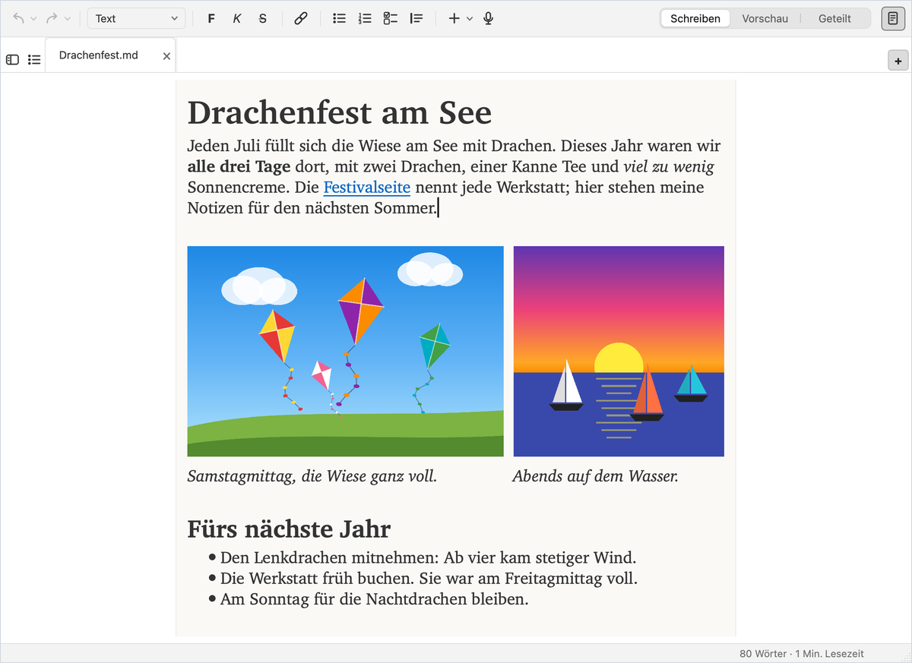
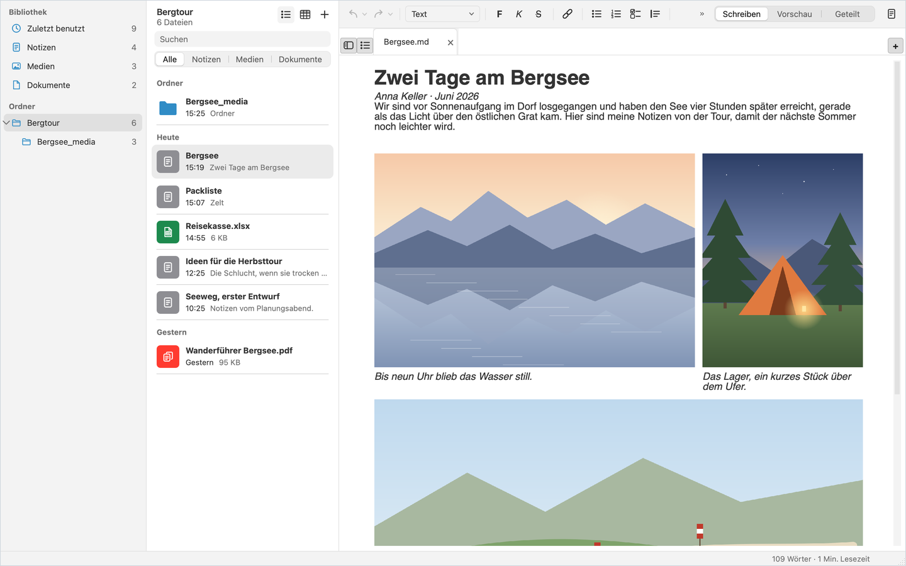
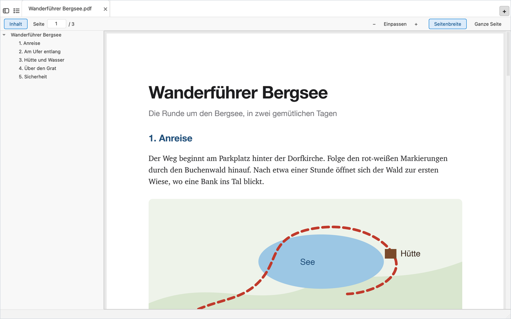
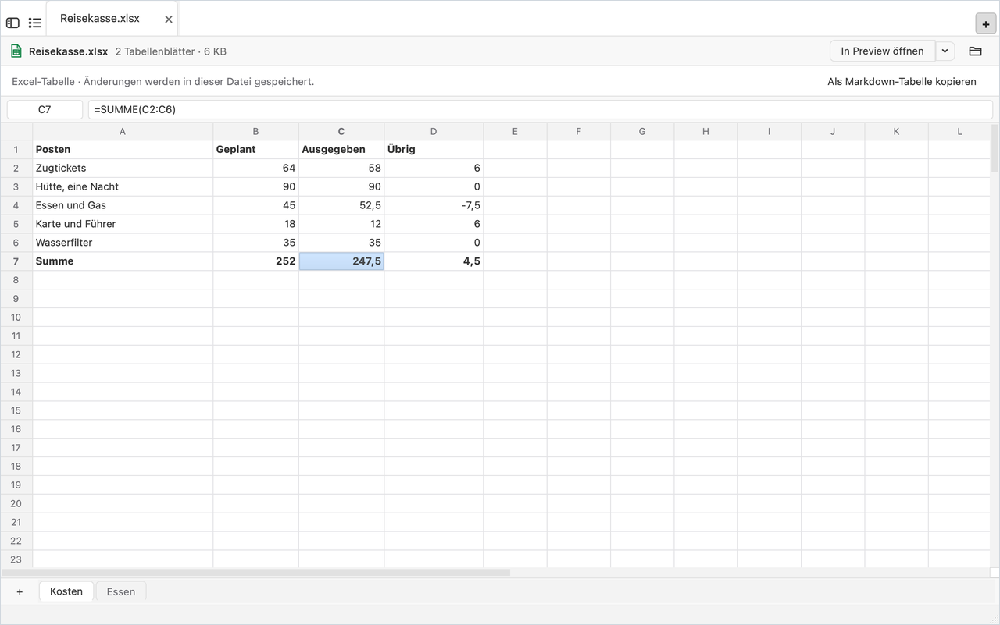

  

<h1 align="center">MyEditor</h1>

  Eine ruhige App zum Schreiben von Notizen und Lesen von PDFs, mit deinen Dateien in deinen eigenen Ordnern. 
  Für Mitschriften, Entwürfe und lange Texte, auf Mac, Windows und Linux, auf Deutsch und Englisch.

  <a href="https://github.com/rinbal/my_editor/releases/latest"><b>Herunterladen</b></a> ·
  <a href="https://rinbal.github.io/my_editor/install/">Installationsanleitung</a> ·
  <a href="docs/use/de/getting-started.md">Erste Schritte</a> ·
  <a href="docs/releases/README.md">Neuigkeiten</a> ·
  <a href="README.md">English</a>

<picture>
  <source media="(prefers-color-scheme: dark)" srcset="docs/images/de/hero-dark.png">
  
</picture>

## Was du damit machen kannst

- **Ohne Ablenkung schreiben.** Überschriften, Listen, Checklisten, Tabellen, Fußnoten und Code, mit den gewohnten Tastenkürzeln deines Systems. Tippe `/` und du siehst alles, was du einfügen kannst. Notizen sind Markdown-Dateien, die jede App öffnet.
- **Bilder als Mosaik zeigen.** Bilder, die aufeinander folgen, werden zur ruhigen Bildgruppe, in der jedes Bild seine Form behält. Bildunterschrift, Beschreibung, Reihenfolge und Zuschnitt änderst du direkt am Bild.
- **PDFs lesen.** Ein stiller Leser, der sich deine Seite merkt, mit den Tasten von SumatraPDF, Suche und Inhaltsverzeichnis.
- **Alle Dateien in deinen Ordnern.** Füge Ordner zur Seitenleiste hinzu und sieh Notizen, Bilder, Filme, PDFs und Office-Dokumente, mit der Übersicht auf der **Leertaste**. Benennst du eine Datei um oder verschiebst du sie, ziehen die Links in deinen Notizen mit.
- **Tabellen bearbeiten.** Excel-, OpenDocument- und CSV-Dateien öffnen sich als Tabellen, die du bearbeiten kannst, mit Formeln auf Deutsch: `=SUMME(C2:C6)`.
- **Eine Notiz mit Passwort schützen.** Sie wird an Ort und Stelle verschlüsselt, in einem offenen Format, das sich auch ohne MyEditor öffnen lässt.
- **Speichern, drucken und exportieren** als HTML, PDF, RTF und R Markdown. HTML- und PDF-Dateien tragen ihre Bilder in sich.
- **Auf Nostr veröffentlichen, wenn du willst.** Schick eine Notiz oder einen Artikel ins offene Nostr-Netz, behalte verschlüsselte Entwürfe auf all deinen Geräten und verwalte deine Medien. Bis du es wählst, bleibt das alles unsichtbar.

## Genauer hingeschaut

  <a href="docs/use/folders-and-files.md"><picture>
    <source media="(prefers-color-scheme: dark)" srcset="docs/images/de/folders-dark.png">
    
  </picture></a>
  <a href="docs/use/pdf.md"><picture>
    <source media="(prefers-color-scheme: dark)" srcset="docs/images/de/pdf-dark.png">
    
  </picture></a>
  <a href="docs/use/spreadsheets.md"><picture>
    <source media="(prefers-color-scheme: dark)" srcset="docs/images/de/sheet-dark.png">
    
  </picture></a>

Von links: [deine Ordner neben deinem Text](docs/use/folders-and-files.md), [ein PDF-Leser zum Lesen](docs/use/pdf.md) und [Tabellen, direkt bearbeitet](docs/use/spreadsheets.md), mit Formeln auf Deutsch. Die verlinkten Seiten der Anleitung sind auf Englisch.

## Installieren

Lade die Datei für deinen Computer aus der [neuesten Version](https://github.com/rinbal/my_editor/releases/latest) herunter, oder lass dir von der [Installationsanleitung](https://rinbal.github.io/my_editor/install/) die richtige heraussuchen.

- **Mac:** Öffne die `.dmg` und zieh MyEditor in den Ordner „Programme“ (`-arm64` für Apple Silicon, `-x86_64` für Intel).
- **Windows:** Starte die `-windows-setup.exe`.
- **Linux:** Die `.deb` für Ubuntu, Debian, Mint und Pop!_OS, sonst das AppImage.

> [!NOTE]
> MyEditor ist nicht von Apple oder Microsoft signiert. Deshalb fragt dein System beim ersten Öffnen einmal nach. Die [Installationsanleitung](https://rinbal.github.io/my_editor/install/) zeigt jede Abfrage mit Bild.

Neue Versionen bietet dir MyEditor selbst an, direkt in der App.

## Aus dem Quellcode starten

Für die Entwicklung oder ein System ohne Installer brauchst du Python 3.11 oder neuer (getestet wird mit 3.12). Die Befehle stehen im englischen README unter [Run from source](README.md#run-from-source).

## Hilfe, Mitmachen und Lizenz

- **Hilfe:** Fang mit den [ersten Schritten](docs/use/de/getting-started.md) an. Die ausführliche [Anleitung](docs/README.md) gibt es auf Englisch. Fragen sind im [Community-Chat][chat] willkommen, Fehler meldest du in den [Issues](https://github.com/rinbal/my_editor/issues).
- **Mitmachen:** Fehlerberichte, Tests und Übersetzungen helfen genauso wie Code. Wie, steht in [CONTRIBUTING.md](CONTRIBUTING.md); neue Sprachen erklärt [Translating](docs/develop/translating.md). Sicherheitslücken bitte nach [SECURITY.md](SECURITY.md) melden.
- **Lizenz:** MyEditor ist freie Software unter der [GNU Affero General Public License v3.0 oder neuer](LICENSE) (AGPL-3.0-or-later). Copyright (C) 2026 rinbal. Die von STANDUP übernommenen Teile der Bildgruppen stehen weiter unter der MIT-Lizenz von STANDUP; welche Dateien das sind, steht im [englischen README](README.md#help-contributing-and-licence).

[chat]: https://nostr-ecosystem.netlify.app/join/g/groups.0xchat.com/my-editor-public-talk?n=My+Editor+-+Public+Talk&a=A+community+for+users%2C+contributors%2C+and+anyone+interested+in+a+clean%2C+distraction-free+note-taking+editor+built+with+Python+and+PySide6.%0A%0AS&p=https%3A%2F%2Fblossom.primal.net%2F6173a8dc06038a1d67d6149755166fb48d74d92d41ef6af8b6cd863489eb3095
