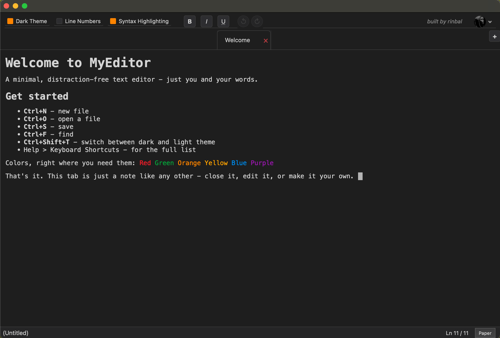

# MyEditor

**A clean, distraction-free desktop text editor. Write locally, publish to Nostr, keep your key on this computer or in your own signer app.**

<p align="center">
  
</p>

MyEditor is a fast, local-first note editor for lecture notes, quick drafts, and
long-form writing. Write in a calm, focused window, then publish straight to Nostr
as a short note or a full article. Your files stay on your disk, and your private
key stays where you put it: protected on this computer, or in a signer app on your
phone, where it can move any time.

<p align="center">
  <a href="https://github.com/rinbal/my_editor/releases/latest"><b>Download for Windows, macOS, or Linux</b></a>
</p>

---

## Highlights

**Focused writing.** A real writing editor with each platform's own keys:
headings, lists, checklists, quotes, tables, footnotes and code blocks, links,
a slash menu, Markdown shortcuts as you type, and Write, Preview and Split
views. Spelling is checked as you type with your system's own checker. Choose
your font and its size, zoom the text, and pick light, dark or automatic
appearance, tabs, line numbers, and lined / dotted / grid backgrounds. Text
runs across the whole window, or on a page of its own in Paper Mode. In English
or German.

**Your folders, every file.** Add your folders to the sidebar and see everything
in them, as in the Finder: notes, pictures, films, sound, PDFs, spreadsheets and
office documents, in a list or a gallery, with search and Quick Look on `Space`.
Move, rename and delete the real files (into the Trash), and the links in your
notes follow. Pictures, films, sound and Word or Writer documents open in viewers
of their own, with Open in your app, Insert into Note and Import as Note.
Spreadsheets (`.xlsx`, `.ods`, `.csv`, `.tsv`) open as tables you can edit, with
formulas in your language. Side panels open beside the text, never over it.

**Private when you need it.** Lock any document with a password: it is
encrypted in place in the open age format (it opens without MyEditor too), and
its crash backups are encrypted as well.

**Dictate and listen.** Start Dictation uses your Mac's dictation or Windows
Voice typing, and dictates offline on this computer where there is none (Linux,
or Windows by choice) after a one-time download, your voice never leaving it.
Edit > Speech reads a draft aloud.

**Publish to Nostr.** Send notes or long-form articles signed on your phone via
NIP-46, keep private encrypted drafts that sync across your devices, and manage
media on your own Blossom servers. New to Nostr? Create an account in the app,
with a password-protected backup. EINUNDZWANZIG membership lives in the Nostr
menu too: members get the members' relay, media storage and a Nostr address,
and see all of it at a glance.
[Read the Nostr guide](docs/nostr.md).

**Import from anywhere.** Nostr > Imports follows websites and keeps their new
posts in an inbox on this computer until you make private drafts of the ones you
want. It reads RSS / Atom / JSON feeds, Nostr authors and articles, NostrHub
NIPs, Bluesky threads, Markdown files and GitHub folders, sitemaps, WordPress
and Ghost exports, Medium and Substack ZIPs, and podcast feeds (with chapters).
Read a post before anything is signed, fetch the whole article for feeds that
send a summary, and copy images to your media server. Your sources are one
private list on your relays, shared with EINUNDZWANZIG STANDUP; OPML lists come
in and go out.

**Reads PDFs, too.** A built-in distraction-free PDF viewer: open any PDF in a
tab, find text, select and copy passages straight into your notes, follow links,
zoom or fit to width, browse the table of contents, and pick up on the exact
page you left off. Keyboard-first navigation (j/k, n/p, g, Space) follows the
muscle memory of readers like SumatraPDF, and regenerated PDFs (LaTeX builds,
re-exports) refresh in place.

**Stays out of your way.** Crash recovery, session restore, external-change
detection, recent files, drag and drop, and export to `.txt`, `.html`, `.pdf`,
`.md`, `.rtf`, and `.Rmd`. HTML and PDF exports are self-contained (images
embedded, metadata, page numbers, Page Setup dialog).

**R Markdown.** Open and edit `.Rmd` files as source, convert rich documents to
R Markdown, and knit to HTML or PDF; missing toolchain parts (R, pandoc,
rmarkdown, TinyTeX) install on demand from their official sources.

> Tested on Windows, macOS and Linux with every change.

---

## Install

The **[step-by-step install guide](https://rinbal.github.io/my_editor/install/)**
picks the right file for your computer and shows every security prompt with a
picture. In short, download the file for your system from the
[latest release](https://github.com/rinbal/my_editor/releases/latest) and open it.

- **Windows:** run the `-windows-setup.exe`. If SmartScreen warns, click
  **More info**, then **Run anyway**.
- **macOS:** open the `.dmg` and drag MyEditor onto **Applications** (follow the
  arrow). Open it once and click **Done**, then click **Open Anyway** in
  **System Settings > Privacy & Security**. Use `-arm64` for Apple silicon,
  `-x86_64` for Intel Macs.
- **Linux:** on Ubuntu, Debian, Mint, or Pop!_OS, double-click the `.deb` and
  click **Install**. On any other distribution, use the AppImage:

  ```bash
  chmod +x my-editor-*.AppImage
  ./my-editor-*.AppImage
  ```

The app is unsigned, so the first launch shows a one-time security prompt. The
[install guide](https://rinbal.github.io/my_editor/install/) walks through every
prompt step by step, and [docs/install.md](docs/install.md) has the same steps
as text.

---

## Documentation

- [Install guide](https://rinbal.github.io/my_editor/install/) ([as text](docs/install.md)) - downloads, security prompts, troubleshooting
- [Nostr publishing, drafts, media, and RSS import](docs/nostr.md)
- [Keyboard shortcuts, menus, and save formats](docs/usage.md)
- [Release process](docs/release-process.md) - for maintainers
- [Maintaining the install guide](docs/install-guide.md) - for maintainers

---

## Run from source

For development, or on a platform without a prebuilt installer (Python 3.10+):

```bash
git clone https://github.com/rinbal/my_editor.git
cd my_editor
python -m venv .venv
source .venv/bin/activate
pip install -r requirements.txt
python main.py
```

Open a file directly with `python main.py /path/to/file.txt`.

---

## License

MyEditor is free software, licensed under the [GNU Affero General Public License v3.0 or later](LICENSE).

Copyright (C) 2026 rinbal.

The photo group engine and page parts taken over from STANDUP keep STANDUP's MIT licence, Copyright (c) 2026 DoktorShift ([LICENSES/MIT-STANDUP.txt](LICENSES/MIT-STANDUP.txt)): `photo_layout.py`, `web/photo_layout.js`, `web/photo_viewer.js`, `web/photo_groups.js`, `web/photo_groups.css` and `web/photo-group-messages.json`, and the test data `tests/fixtures/photo_layout_vectors.json` and `tests/fixtures/photo_markup_cases.json`.

This program is distributed in the hope that it will be useful, but WITHOUT ANY WARRANTY; without even the implied warranty of MERCHANTABILITY or FITNESS FOR A PARTICULAR PURPOSE. You should have received a copy of the license along with this program; if not, see <https://www.gnu.org/licenses/>.

---

*built by rinbal & the Community*

Join the Public [Community Chat](https://nostr-ecosystem.netlify.app/join/g/groups.0xchat.com/my-editor-public-talk?n=My+Editor+-+Public+Talk&a=A+community+for+users%2C+contributors%2C+and+anyone+interested+in+a+clean%2C+distraction-free+note-taking+editor+built+with+Python+and+PySide6.%0A%0AS&p=https%3A%2F%2Fblossom.primal.net%2F6173a8dc06038a1d67d6149755166fb48d74d92d41ef6af8b6cd863489eb3095) to Discuss, Report or provide Feedback or Feature Requests.

