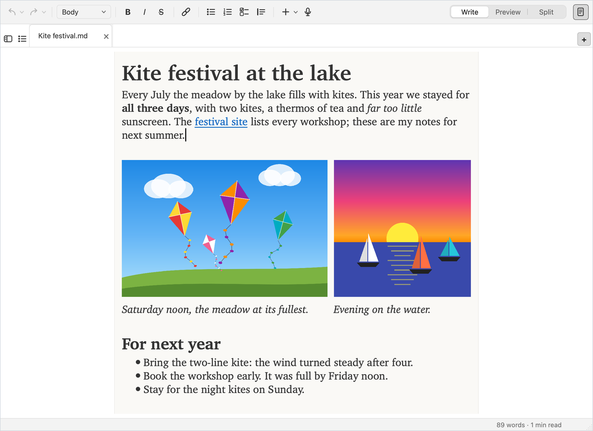
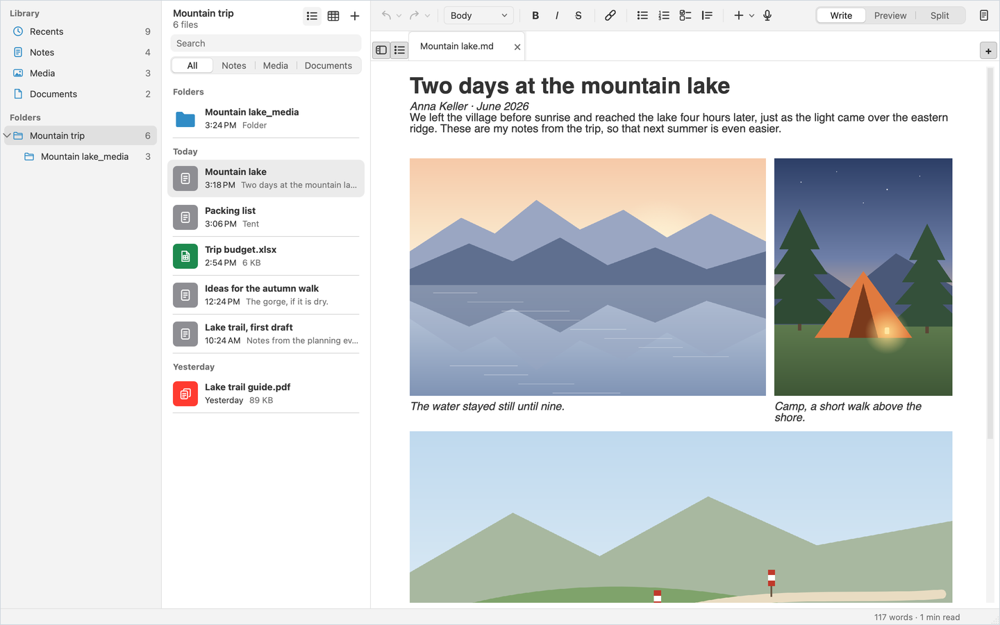
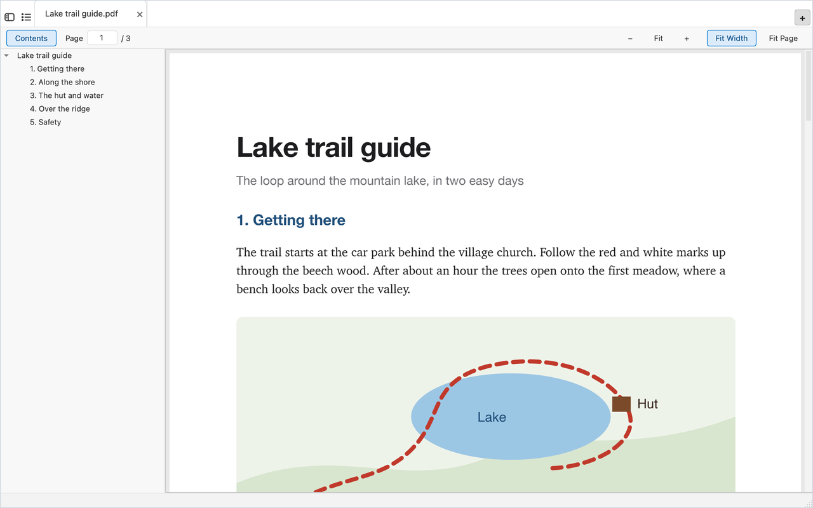
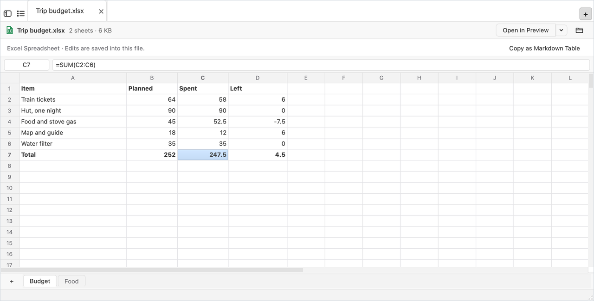

<p align="center">
  
</p>

<h1 align="center">MyEditor</h1>

<p align="center">
  A calm app for writing notes and reading PDFs, with your files in your own folders.<br>
  For lecture notes, drafts and long-form writing, on Mac, Windows and Linux, in English and German.
</p>

<p align="center">
  <a href="https://github.com/rinbal/my_editor/releases/latest"><b>Download</b></a> ·
  <a href="https://rinbal.github.io/my_editor/install/">Install guide</a> ·
  <a href="docs/README.md">User guide</a> ·
  <a href="docs/releases/README.md">What's new</a> ·
  <a href="README.de.md">Deutsch</a>
</p>

<picture>
  <source media="(prefers-color-scheme: dark)" srcset="docs/images/hero-dark.png">
  
</picture>

## What you can do

- **Write without distraction.** Headings, lists, checklists, tables, footnotes and code, with each system's own keys. Type `/` for everything you can insert. Notes are Markdown files any app can open.
- **Show pictures as a mosaic.** Pictures that follow each other become a calm photo group in which each keeps its shape. Caption, describe, move and crop them where they stand.
- **Read PDFs.** A quiet reader that remembers your page, with the keys of SumatraPDF, search, and its table of contents.
- **Keep every file in your folders.** Add folders to the sidebar and see notes, pictures, films, PDFs and office documents, with Quick Look on **Space**. Rename or move a file, and the links in your notes follow.
- **Edit spreadsheets.** Excel, OpenDocument and CSV files open as tables you can edit, with formulas in your language.
- **Lock a note with a password.** It is encrypted in place, in an open format that opens without MyEditor too.
- **Save, print and export** to HTML, PDF, RTF and R Markdown. HTML and PDF files carry their pictures inside.
- **Publish to Nostr, if you like.** Send a note or an article to the open Nostr network, keep encrypted drafts across devices, and manage your media. It stays out of sight until you choose it.

## A closer look

<p>
  <a href="docs/use/folders-and-files.md"><picture>
    <source media="(prefers-color-scheme: dark)" srcset="docs/images/folders-dark.png">
    
  </picture></a>
  <a href="docs/use/pdf.md"><picture>
    <source media="(prefers-color-scheme: dark)" srcset="docs/images/pdf-dark.png">
    
  </picture></a>
  <a href="docs/use/spreadsheets.md"><picture>
    <source media="(prefers-color-scheme: dark)" srcset="docs/images/sheet-dark.png">
    
  </picture></a>
</p>

From left: [your folders beside your writing](docs/use/folders-and-files.md), [a PDF reader made for reading](docs/use/pdf.md), and [spreadsheets edited in place](docs/use/spreadsheets.md), with formulas in your language.

## Install

Download the file for your computer from the [latest release](https://github.com/rinbal/my_editor/releases/latest), or let the [install guide](https://rinbal.github.io/my_editor/install/) pick it for you.

- **Mac:** open the `.dmg` and drag MyEditor to Applications (`-arm64` for Apple silicon, `-x86_64` for Intel).
- **Windows:** run the `-windows-setup.exe`.
- **Linux:** the `.deb` on Ubuntu, Debian, Mint and Pop!_OS, the AppImage anywhere else.

> [!NOTE]
> MyEditor is not signed by Apple or Microsoft, so the first launch shows a one-time security prompt. The [install guide](https://rinbal.github.io/my_editor/install/) shows each prompt with a picture, and [Install MyEditor](docs/use/install.md) has the same steps as text.

MyEditor updates itself: it offers each new version in the app.

## Run from source

For development, or on a system without an installer.

<details>
<summary>Steps for developers</summary>

You need Python 3.11 or later (CI tests 3.12):

```sh
git clone https://github.com/rinbal/my_editor.git
cd my_editor
python3 -m venv .venv
source .venv/bin/activate        # Windows: .venv\Scripts\activate
pip install -r requirements.txt
python main.py                   # or: python main.py path/to/file.md
```

</details>

## Help, contributing and licence

- **Help:** start with [Getting started](docs/use/getting-started.md) and the [user guide](docs/README.md). Questions are welcome in the [community chat][chat]; problems go to the [issues](https://github.com/rinbal/my_editor/issues).
- **Contributing:** reports, tests and translations help as much as code. [CONTRIBUTING.md](CONTRIBUTING.md) says how, and [Translating](docs/develop/translating.md) how to add a language. Security problems: [SECURITY.md](SECURITY.md).
- **Licence:** MyEditor is free software under the [GNU Affero General Public License v3.0 or later](LICENSE) (AGPL-3.0-or-later). Copyright (C) 2026 rinbal. A few photo group files from STANDUP keep STANDUP's MIT licence:

  <details>
  <summary>Files under STANDUP's MIT licence</summary>

  The photo group engine and page parts taken over from STANDUP keep STANDUP's MIT licence, Copyright (c) 2026 DoktorShift ([LICENSES/MIT-STANDUP.txt](LICENSES/MIT-STANDUP.txt)): `photo_layout.py`, `web/photo_layout.js`, `web/photo_viewer.js`, `web/photo_groups.js`, `web/photo_groups.css` and `web/photo-group-messages.json`, and the test data `tests/fixtures/photo_layout_vectors.json`, `tests/fixtures/photo_markup_cases.json` and `tests/fixtures/standup_editorial_fixtures.json` (a copy of STANDUP's `docs/editorial-fixtures.json`).

  </details>

[chat]: https://nostr-ecosystem.netlify.app/join/g/groups.0xchat.com/my-editor-public-talk?n=My+Editor+-+Public+Talk&a=A+community+for+users%2C+contributors%2C+and+anyone+interested+in+a+clean%2C+distraction-free+note-taking+editor+built+with+Python+and+PySide6.%0A%0AS&p=https%3A%2F%2Fblossom.primal.net%2F6173a8dc06038a1d67d6149755166fb48d74d92d41ef6af8b6cd863489eb3095
