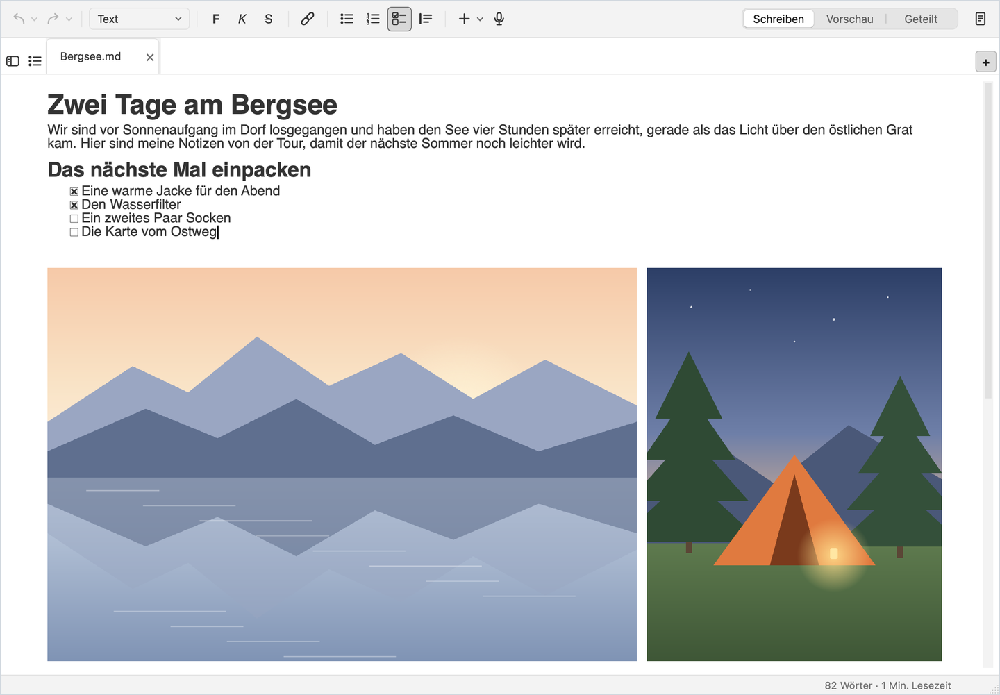

# Erste Schritte

In etwa zehn Minuten schreibst du deine erste Notiz mit Überschrift, Checkliste und ein paar Bildern, speicherst sie in einem eigenen Ordner und öffnest ein PDF. Ein Konto brauchst du dafür nicht.

Tastenkürzel stehen zuerst für den Mac, dann für Windows und Linux: **⌘S** / **Strg+S**.

## 1. MyEditor installieren und öffnen

Lade MyEditor für deinen Computer über die [Installationsanleitung](https://rinbal.github.io/my_editor/install/) herunter. Sie führt dich auch durch die Sicherheitsabfrage, die dein System beim ersten Öffnen stellt. Dieselben Schritte als Text (auf Englisch) findest du unter [Install MyEditor](../install.md).

Beim ersten Start zeigt MyEditor den Tab **Willkommen** mit den wichtigsten Tastenkürzeln. Er ist eine ganz normale Notiz: Lies ihn und schließe ihn dann. Über **Hilfe > Willkommen** holst du ihn jederzeit zurück.

## 2. Eine Notiz schreiben

1. Wähle **Datei > Neu** (**⌘N** / **Strg+N**). Ein neuer Tab öffnet sich.
2. Tippe einen Titel, zum Beispiel *Zwei Tage am Bergsee*.
3. Mach ihn zur Überschrift: Wähle **Format > Stil > Überschrift 1** (**⌥⌘1** / **Strg+1**) oder nimm sie im Stil-Menü in der Symbolleiste.
4. Drücke die Eingabetaste und schreib ein, zwei Sätze. Nach einer Überschrift geht es mit normalem Text weiter.
5. Tippe **Das nächste Mal einpacken**, mach daraus eine **Überschrift 2**, drücke die Eingabetaste und wähle **Format > Checkliste** (**⇧⌘9** / **Strg+Umschalt+9**). Schreib ein paar Punkte, einen pro Zeile. Ein Klick auf ein Kästchen hakt es ab.

> [!TIP]
> Tippe `/` am Anfang eines Wortes: Eine kurze Liste zeigt alles, was du einfügen kannst, von Überschriften über Listen bis zu Tabellen und Bildern. Tippe ein paar Buchstaben, um sie einzugrenzen, und drücke die Eingabetaste.

Markierst du ein paar Wörter mit der Maus, erscheint darüber eine kleine Leiste mit Fett, Kursiv, Link und dem Absatzstil. Alles andere findest du in den Menüs **Format** und **Einfügen**.

## 3. Bilder einfügen

Wähle **Einfügen > Bild …** und such dir ein Bild aus, oder zieh eines aus dem Finder oder Explorer auf die Seite.

Füge direkt darunter zwei weitere hinzu. Bilder, die aufeinander folgen und nur durch Leerzeilen getrennt sind, werden zur **Bildgruppe**: einem ruhigen Mosaik, in dem jedes Bild seine Form behält. Zeigst du mit der Maus auf ein Bild, erscheinen kleine Knöpfe: **ALT** für eine Bildbeschreibung, die Bildschirmleser vorlesen, **Groß** für eine eigene Zeile über die ganze Breite und **Mehr** für alles andere. Alle Befehle stehen auch unter **Format > Bild**.

Deine Notiz sieht jetzt etwa so aus:

<picture>
  <source media="(prefers-color-scheme: dark)" srcset="../../images/de/firstnote-dark.png">
  
</picture>

## 4. Speichern

Wähle **Datei > Speichern** (**⌘S** / **Strg+S**), gib der Notiz einen Namen und wähle, wohin sie soll. Notizen werden als Markdown gespeichert (`.md`), als reiner Text, den jede andere App öffnen kann.

Die Bilder, die du eingefügt hast, landen in einem Ordner neben der Notiz, der nach ihr benannt ist (`Bergsee_media`). So bleiben Notiz und Bilder zusammen, egal wohin du sie verschiebst.

Ab jetzt speichert **⌘S** / **Strg+S** ohne Rückfrage. Außerdem sichert MyEditor laufend, was du tippst: Selbst nach einem Absturz sind deine Worte noch da.

## 5. Notizen in einem Ordner ablegen

Die Seitenleiste links zeigt die Ordner, die du auswählst.

1. Wähle **Datei > Ordner zur Seitenleiste hinzufügen …** (**⌃⌘T** auf dem Mac) oder klicke in der Seitenleiste auf **Ordner hinzufügen …** und wähle den Ordner mit deiner Notiz.
2. Klicke auf den Ordner. Die Dateiliste daneben zeigt seine Dateien, die neuesten zuerst.
3. Wähle eine Datei aus und drücke die **Leertaste**, um sie in der **Übersicht** anzusehen, ohne sie zu öffnen. Mit der Eingabetaste öffnest du sie in einem Tab.

Alles, was du hier tust, passiert mit den echten Dateien. Es gibt keine versteckte Bibliothek. Benennst du ein Bild um oder verschiebst du eine Notiz, ziehen die Links in deinen anderen Notizen mit.

## 6. Ein PDF lesen

Öffne ein PDF mit **Datei > Öffnen …** (**⌘O** / **Strg+O**) oder klicke es in der Dateiliste an. Es erscheint in einem ruhigen Leser: Die **Leertaste** blättert einen Bildschirm weiter, **n** und **p** springen zur nächsten und vorherigen Seite, und **F12** blendet das Inhaltsverzeichnis ein (**Inhalt** in der Symbolleiste). MyEditor merkt sich, wo du warst.

## Wie es weitergeht

- Richte dir das Fenster ein: **Darstellung > Erscheinungsbild** für hell oder dunkel, **Darstellung > Papiermodus** für eine eigene Seite, und **Einstellungen …** (**⌘,** / **Strg+,**) für Schrift und Schriftgröße.
- **Hilfe > Tastaturkurzbefehle** zeigt alle Tastenkürzel, mit den Tastennamen deiner Tastatur.
- Die ausführliche Anleitung gibt es auf Englisch: [Writing](../writing.md), [Pictures and photo groups](../pictures.md), [Save, export and print](../save-export-print.md), [Reading PDFs](../pdf.md), [Folders and files](../folders-and-files.md), [Spreadsheets](../spreadsheets.md) und [Privacy and safety](../privacy.md).
- Du willst veröffentlichen, was du schreibst? [Publishing to Nostr](../nostr/README.md) ist freiwillig und bleibt aus dem Weg, bis du es wählst. Du findest es im Menü **Nostr**.
