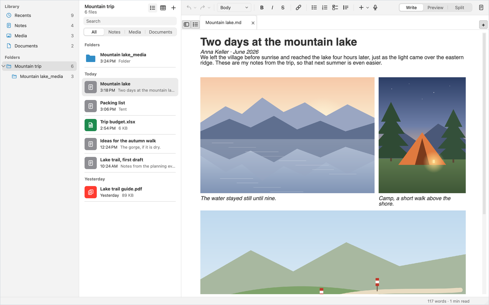

# Folders and files

MyEditor shows your folders the way the Finder and Apple Notes do: the sidebar on the left, the files of the folder you choose beside it, and the file you open on the right. The disk is the truth. There is no database and no hidden copy: what you move, rename or delete here happens to the real file, and what you change in the Finder or Explorer shows here at once.

<picture>
  <source media="(prefers-color-scheme: dark)" srcset="../images/folders-dark.png">
  
</picture>

## The sidebar

Choose **File > Add Folder to Sidebar…** (**⌃⌘T** on a Mac), or **Add Folder…** in the sidebar, to add a folder: your notes, a project, a shared drive. Add as many as you like. The sidebar has two parts:

- **Library** gathers files from every folder you added: **Recents** (changed most lately), **Notes**, **Media** (pictures, films and sound) and **Documents** (PDFs, spreadsheets and everything else).
- **Folders** lists each folder you added, with its subfolders under it.

Right-click a folder for **New Note**, **New Folder**, **Add Files…**, **Show in Finder** (**Show in Explorer**, **Show in File Manager**), **Copy Path**, **Rename…** and **Move to Trash**. **Remove from Sidebar** only forgets a folder here; nothing on the disk changes.

**View > Hide Sidebar** (**⌃⌘S** on a Mac) hides it when you only want to write.

## The file list

The list beside the sidebar shows the files of what you chose there, newest first, grouped by day (**Today**, **Yesterday**, **Previous 7 Days** and so on). A note shows its first line, a picture its size in pixels, any other file its size on the disk.

- **List or gallery**: the two buttons at the top switch between a list and a gallery of small pictures.
- **All, Notes, Media, Files**: the switch under the search field shows one kind only.
- **Search**: finds files by name, and notes by their first line.
- **Quick Look**: select a file and press **Space** to see it in a panel over the window. The arrow keys move through the list and the panel follows. **Space** or **Escape** closes it.
- **New Note** (the **+** button) makes a note in the folder shown.

**View > Show File List** (**⌃⌘L** on a Mac) hides and shows the list.

## Move, rename and delete

- Drag files onto a folder in the sidebar to move them, or use **Move to…** in the right-click menu.
- Files dragged in from the Finder or Explorer are copied into the folder you drop them on. Files dragged out to the Finder, Mail or Messages are the real files.
- **Rename…** asks before it changes a file's extension, as the Finder does.
- **Move to Trash** (**⌘⌫** / **Delete**) asks first, then puts the files in the Trash (the Recycle Bin on Windows), where you can get them back.

**Links keep working.** When you rename or move a file, every note in your sidebar folders that links to it is updated, and a note's pictures folder (`<name>_media`) moves and is renamed with its note. The status bar says how many notes were updated. A note that is open with unsaved changes is left alone, and the status bar names it, so nothing you typed is overwritten.

## Every kind of file

Click a file to open it in a tab. Notes and text open in the editor, PDFs in the [PDF reader](pdf.md), spreadsheets as [tables you can edit](spreadsheets.md). Everything else gets a viewer:

- **Pictures** fit the window, with **Fit**, **Zoom In** and **Zoom Out**.
- **Films and sound** play in a player of their own.
- **Word and Writer documents** (`.docx`, `.odt`) open in a reading view with their text, tables and pictures, without the exact page layout. With pandoc the view is closer to the original; **Install pandoc…** installs it from its official source.
- **Numbers, Pages, Keynote, PowerPoint and older Office files** show the preview picture their app saved in the file.
- **Any other file** shows a card with its kind, size and the date it changed.

The bar above a viewer offers only what makes sense for the file:

- **Open in Numbers** (or Excel, LibreOffice, Preview: always the app your computer uses for that file). The arrow beside it is **Open With**, with the other apps that can open it. When no app is set, the button says **Open With…**.
- **Show in Finder** (**Show in Explorer**, **Show in File Manager**).
- **Insert into Note**, for pictures, films and sound: puts the file into the note you are writing. A file in the same sidebar folder as the note is linked where it is, without a copy.
- **Import as Note**, for `.docx` and `.odt`: makes a Markdown note of the document beside it, with its pictures in the note's own folder. The document stays as it is.

The file list's right-click menu has the same commands. When an office file is open in another app, the viewer says so and shows the last saved version.

## Room for the text

The sidebar, the file list and the other panels open beside the text, never over it: the window grows to make room, so the text keeps its place and its width. Closing a panel gives the room back. When the screen is full, the text gives way, but never below a readable line; if even that does not fit, the file list folds away first.

Drag the thin line between a panel and the text to make the panel wider or narrower. MyEditor remembers each width.
