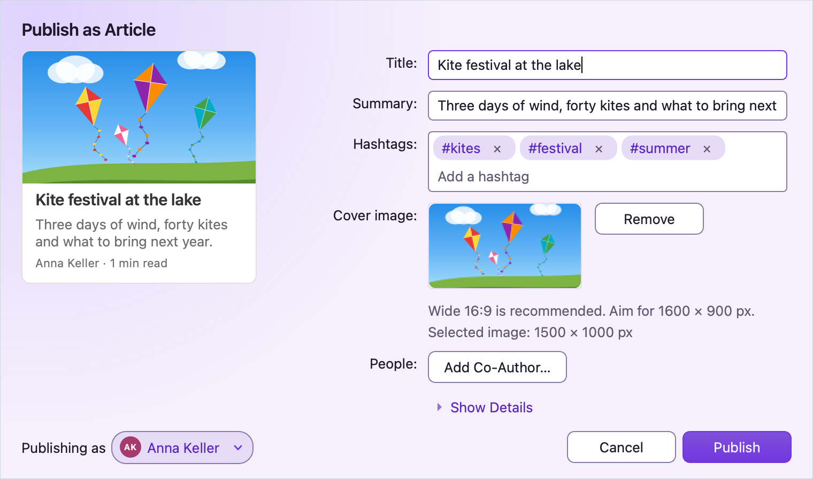

# Publish notes and articles

Write in MyEditor as always, then choose how it goes out: as a short **note**, or as a long-form **article** with a title, a summary, a cover and hashtags. Both need an account in use ([Your account](account.md)). With a signer app, it asks you to approve each post.

## Publish a note

Choose **Nostr > Publish as Note…** (**⌥⌘P** / **Ctrl+Shift+P**). A sheet slides over the window with the note's text in a box. Notes are plain text, as Nostr apps show them, so bold and italic are left out; list markers and link addresses stay. You can still change the text in the box; your document stays as it is. **People** under the box shows, by name, everyone the note will tag. Click **Publish**.

## Publish an article

Choose **Nostr > Publish as Article…** (**⇧⌘A** / **Ctrl+Shift+A**). The sheet shows the article's details and a **Preview** card of how readers see it in their lists:

- **Title**: the article's own, else its first heading.
- **Summary**: one sentence, shown under the title in feeds.
- **Hashtags**: **Return** or a comma makes a tag, **×** or **Backspace** removes one.
- **Cover image**: **Choose…** from your [Media Library](media.md), drop a picture file on it, or **Remove** it. **Adjust…** frames it; 16:9 at 1600 × 900 pixels suits most readers.
- **People**: everyone the article tags, by name: people mentioned in the text, authors it quotes, and co-authors.
- **Show Details**: the article's **Link name**, the last part of its web address. It is made from the title until you type one.

<picture>
  <source media="(prefers-color-scheme: dark)" srcset="../../images/publish-dark.png">
  
</picture>

The article's text is your document exactly as written: headings, bold, italic, links, lists, quotes, code, tables, footnotes and photo groups. Underline and colors have no Markdown and stay in your local file.

**Before it goes out, MyEditor checks the article.** Under the fields the sheet says what still keeps it from going out, such as a missing title or a cover address that can't be published, and **Publish** waits until that is fixed. **Show** takes you to the field. What would make the article better, such as a summary or a description for a picture, is one folded line of suggestions; they never stop you. While [STANDUP](einundzwanzig.md) is in use, the check also says what helps an article on Discover. The same verdict is under the article's summary on the page, and in full in **Article Details**. STANDUP's editor checks with the same rules and words.

**Publishing again updates the article.** An article keeps its link name once it is out, so publishing it again replaces the old version at the same address, and readers keep the date it first went out.

## Article Details

**View > Article Details** (**⌥⌘I** / **Ctrl+F5**) opens the same details in a panel beside the document, as Pages has its inspector: first the check before publishing, then title, summary, cover, hashtags, authors, and under **Advanced** the link name and when it first went out. What you type there belongs to the article at once, and the publish sheet shows the same.

A Markdown file keeps these details in its front matter, the block at its top that Jekyll, Hugo and Obsidian use. MyEditor changes only the lines you changed, in the file's own style, and leaves everything else in that block as written.

## Write in another language

With a Nostr account in use, choose the **Languages** icon beside **Preview**, or **Nostr > Write in another language…**. Search for a language by name, including its native name, and choose it. A blank document opens immediately; choosing an existing version returns to its text. The recent choices are a shortcut to the full offline catalogue, including Thai, Lao, Khmer and Japanese.

The original stays beside your writing as a read-only reference. The reference icon hides it; in a narrow window the same action opens it and returns to your writing. **Article Details** uses that supplementary space. Selecting or copying reference text never changes what **Publish** sends. If a published reference changes, **Review** lets you compare it and deliberately use the new reference; unpublished original edits are not included automatically.

**Publish English**, for example, publishes only the English document. The review states when the original stays a private draft. The arrow attached to Publish offers **Publish both…**, shows both versions and names both in its final action. If one version already published, retry keeps that success and sends only unfinished work. Save linked documents as Markdown or encrypted drafts to retain their private references; plain shared drafts do not carry private reference data between devices.

## Co-authors and zaps

**Add Co-Author…** names a person as a co-author. That is credit and nothing more. If you also want to share the zaps readers send, turn on **Share zaps equally with co-authors**: then everyone, you included, gets an equal share. A co-author without a Lightning address in their profile cannot receive zaps, and a line under the option says so. [Decision 4](../../decisions/0004-co-author-credit-zaps-optional.md) explains why.

## Mention people and quote posts

- **Mention**: type `@` at the start of a word, or choose **Insert > Mention…**. A list opens with the people you follow first; type a name to narrow it and choose one. "@Name" goes into the text as a link to the person, who hears about it. **Backspace** right after a mention removes it whole.
- **Quote a note or an article**: choose **Insert > Note or Article…** and paste its link (a `nostr:` link, or the address njump.me, Primal or YakiHonne shows it at). Readers show it as a card.
- **Audio and video**: **Insert > Audio or Video…**, or drop the file on the window. It shows as a card and goes to your media servers as a picture does; readers show a player. Nothing is published while an upload is still on its way.

## Pictures

Pictures you put into a document stay on this computer until you publish, then go to your media servers. **Settings > Upload files: Right Away** uploads them as soon as you add them instead. Camera and location details are removed from a cover before it is uploaded.

## Submit to a publication

Publications on [EINUNDZWANZIG STANDUP](https://media.einundzwanzig.space) have an editorial team that reads what writers hand in. You don't need to be a member: a publication that takes guest posts takes them from anyone.

- **Nostr > Submit to a Publication…** hands in the text in front: title, summary and cover as in **Publish as Article**, then the publication. The sheet says who publishes the text: you, or the publication under your name.
- **Nostr > Submissions** (**⇧⌘Y** / **Ctrl+Shift+Y**) lists what you handed in, with each one's state and your conversation with the team. From there you can **Hand In New Version…**, **Withdraw…**, **Take the Correction** or **Ask a Question**.
- When the team accepts the text, **Confirm Share…** shows how the zaps are shared, and you confirm. A Lightning address in your profile lets your share reach you; you can add it later too.

The text and the conversation are encrypted end to end. The server sees titles and states, never the text.

## What you published

Choose **Nostr > Published** (**⇧⌘B** / **Ctrl+Shift+B**) to see your notes and articles, newest first, in the Drafts panel's **Published** view. **Load More Notes** at the end brings older notes. **Nostr > Refresh Drafts** (**⌘R** / **F5**), which is named for the view shown, reads the list again. Right-click a row, or press the Menu key, for:

- **Edit Article**: opens it in a tab. Publishing it again replaces it and keeps its address and first date.
- **Open in Standup Discover** (**Open in njump** for a note), or in the reader you chose under **Settings > Open posts on the web in**: shows it on the web. **Open With** offers the other readers, such as njump, YakiHonne, Primal and noStrudel.
- **Copy Link**: copies its web address, to share.
- **Delete from Nostr…**: asks first, then asks the relays to remove it. People and apps that already saved a copy may still have it.

## If something goes wrong

When no relay takes a post, the sheet says so in one sentence and offers **Try Again**; nothing is lost. When only some relays answer, MyEditor carries on quietly: one relay is enough for readers to find your post.
