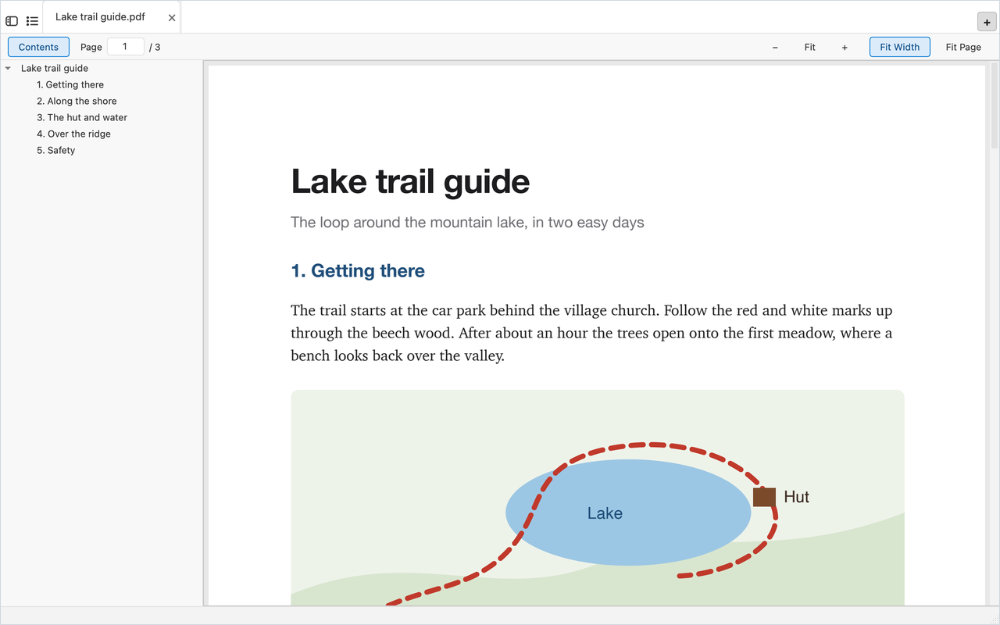

# Reading PDFs

MyEditor opens PDFs in a reader made for reading and nothing else: a slim toolbar with the contents, the page number and the zoom, and the pages. It does not edit PDFs.

<picture>
  <source media="(prefers-color-scheme: dark)" srcset="../images/pdf-dark.png">
  
</picture>

## Open a PDF

Open a PDF with **File > Open…**, by dragging it onto the window, by double-clicking it in the Finder or Explorer, from **File > Recent Files**, or by clicking it in the [file list](folders-and-files.md). A PDF with a password asks for it.

MyEditor remembers the page and the zoom you left each PDF at, and opens it there next time. When the file changes on the disk while it is open, for example because you built it again from LaTeX or exported it again, the reader loads the new version at the same place.

## Move around

The keys are those of SumatraPDF and of most web browsers. Letters and **Space** work while the page has the focus.

| To | Press |
|---|---|
| Go down or up a screen | **Space** / **Shift+Space** |
| Scroll a little | **j** / **k** |
| Next or previous page | **n** / **p** |
| Go to a page | **g**, type the number, **Return** |
| First or last page | **Home** / **End** |
| Show or hide the contents | **F12** |

You can also type a page number in the box on the toolbar. **Contents** on the toolbar shows the PDF's table of contents, when it has one; click an entry to go there. Without one, the button is dimmed.

## Zoom

| To | Mac | Windows and Linux |
|---|---|---|
| Zoom in or out | **⌘+** / **⌘−**, or **+** / **−** | **Ctrl+=** / **Ctrl+−**, or **+** / **−** |
| Fit the page's width | **⌘0**, or **Fit Width** | **Ctrl+0**, or **Fit Width** |
| Actual size | **⌥⌘1** | **Ctrl+1** |
| Fit the whole page | **⌥⌘2**, or **Fit Page** | **Ctrl+2**, or **Fit Page** |

Hold **⌘** / **Ctrl** and turn the mouse wheel to zoom too.

## Find, select and copy

Press **⌘F** / **Ctrl+F** to find words in the PDF. **Return** and **Shift+Return** go to the next and previous match. A search starts on the page you are reading, not on page one.

Drag across text to select it, then copy it with **⌘C** / **Ctrl+C**. The selection follows the characters as in a text editor, so it pastes cleanly into a note. **Escape** clears it.

Links work as you would expect: a web link opens in your browser, and an entry of the contents or a reference such as "see section 4.2" goes to its page.

## Read without distraction

**View > Enter Full Screen** (**⌃⌘F** / **F11**) fills the screen with the PDF. **View > Show Sidebar** and **View > Show File List** hide the folders when you only want to read.

The pages show as they were made, on white. The space around them follows the app's light or dark appearance.

## Print

**File > Print…** (**⌘P** / **Ctrl+P**) prints the PDF's own pages, each scaled to fit the paper.
