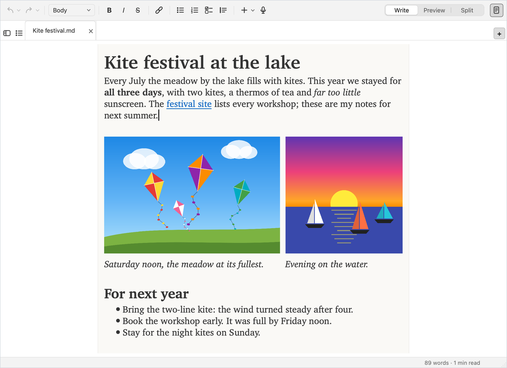

# Pictures and photo groups

Put a picture in with **Insert > Image…** (**⇧⌘V** / **Ctrl+Shift+E**), by dragging it from the Finder or Explorer, or by pasting it. When you save a note, the pictures you added are copied into a folder beside it, named after the note (`Trip_media`), so the note carries its own pictures.

## Photo groups

Pictures that follow each other, with nothing but empty lines between them, form a **photo group**. MyEditor lays a group out as a calm mosaic in rows, in which every picture keeps its shape and nothing is cut off. Make the window wider or narrower and the rows rearrange themselves.

<picture>
  <source media="(prefers-color-scheme: dark)" srcset="../images/hero-dark.png">
  
</picture>

The Markdown stays plain: one picture after another, each with its caption under it. Apps that do not know photo groups show the pictures one under another, in your order, so nothing is lost anywhere.

To start a group, add a second picture right below the first, or use **Format > Photo > Add Photos…**. To split a group, write a line of text between two of its pictures, or choose **Split Group Here**.

## Edit a picture where it stands

Point at a picture, or click it to select it, and four small buttons appear on it:

- **The handle** (top left): drag the picture to another place in the group, into another group, or out on its own. Click it to move the picture with the arrow keys instead; **Return** puts it down, **Escape** cancels.
- **More** (top right): every command for the picture.
- **ALT** (bottom left): the picture's description, which screen readers read aloud and which shows when a picture cannot load. A picture without one says **No ALT**.
- **Large** (bottom right): gives the picture a row of its own across the whole width, for a plan, a map or a panorama. On a picture that stands alone it says **Wide** and shows it wider than the text.

Over a group, a bar names it ("Photo Group · 3 Photos") and offers **+ Photo**.

**Captions.** Click a group picture's caption, or select a picture and press **Return**, to write its caption in place. **Tab** goes on to the next picture's caption, **Shift+Tab** to the one before.

**Move with the keyboard.** With a picture selected, **⌃⌘** / **Ctrl+Shift** and an arrow key move it one place.

## The Photo menu

**Format > Photo** lists every command, dimmed where it does not apply. The picture's right-click menu shows those that do.

| Command | What it does |
|---|---|
| **Move Left**, **Move Right**, **Move Up**, **Move Down** | Moves the picture one place |
| **Move to Start**, **Move to End** | Moves it to the start or end of its group |
| **Move With Arrow Keys** | Picks it up, so the arrow keys move it |
| **Show Large** | A row of its own across the whole width |
| **Take Out of Group** | It stands alone, under or above the group |
| **Split Group Here** | Opens a line for text between two pictures, which makes two groups |
| **Join the Group Above**, **Join the Group Below** | Joins two groups into one |
| **Caption…**, **Description…** | Writes the caption, or the description for screen readers |
| **Crop…** | Keeps part of the picture, as a new file |
| **Add Photos…** | Adds pictures to the group |
| **Remove** | Removes the picture from the note; its file stays on the disk |

Every command is one step of **Undo**.

## Crop

**Crop…** shows the picture with a frame on it, as Photos does. Drag inside the frame to move it, drag an edge or a corner to size it, or choose a format: **Free**, **Original**, **Square**, 3:2, 4:3 or 16:9. The arrow keys move the frame; with **⌥** / **Alt** they size it.

Cropping makes a new picture file. The original is never changed, so **Undo** brings it back, and other notes that show it are untouched.

## Where groups show

- **The editor and the preview** show groups as a mosaic.
- **HTML** (**File > Save As…**) keeps the mosaic. Click a picture to see it full size, with the others of its group a step away.
- **PDF and printing** lay out groups in rows too, and keep a group on one page when it fits.
- **R Markdown** knits a group side by side in HTML, and one under another in PDF and Word. See [Save, export and print](save-export-print.md#r-markdown-knitting).
- **Nostr.** Published articles keep the Markdown as written, so STANDUP and its reader Discover show the mosaic, and other Nostr apps show the pictures one under another.

Photo groups use the same layout as STANDUP, so an article looks the same while you write it and after it is published. [Decision 3](../decisions/0003-photo-groups-follow-standup.md) explains why.
