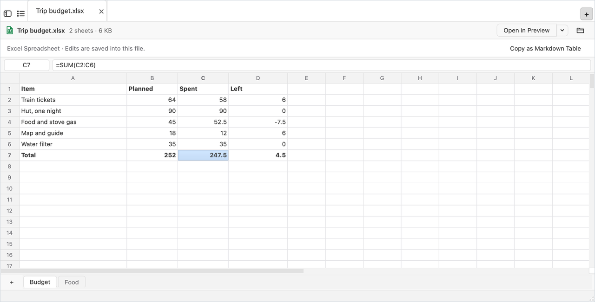

# Spreadsheets

Excel workbooks (`.xlsx`, `.xlsm`), OpenDocument spreadsheets (`.ods`) and text tables (`.csv`, `.tsv`) open in MyEditor as tables you can edit, with a formula bar on top and a tab for each sheet along the bottom. It is made for checking a budget or fixing a list, not for building a model: charts, pivot tables and macros stay with the app that made them.

<picture>
  <source media="(prefers-color-scheme: dark)" srcset="../images/sheet-dark.png">
  
</picture>

## Edit cells

Editing works the way Numbers, Excel and LibreOffice Calc taught you:

- Type to replace a cell. **F2** or a double-click edits it in place.
- **Return** confirms and goes down, **Tab** goes right, **Escape** cancels, **Delete** clears.
- Undo takes back every step.
- Type a cell's name (`C12`) in the box at the left of the formula bar to go there.

## Formulas and numbers in your language

In German you write `=SUMME(A1:A3;1,5)` and `12,5`, as German Excel does; in English `=SUM(A1:A3,1.5)` and `12.5`. The file keeps the spelling every spreadsheet app reads, in any language.

MyEditor calculates the common functions itself. A formula it cannot calculate shows the result the spreadsheet app saved, and says so.

## Rows, columns and sheets

- Right-click a row number or a column letter to insert rows above or below, columns before or after, or to delete them.
- **Format > Sheet** adds, duplicates, renames and deletes sheets. So does the right-click menu on a sheet's tab.
- **Copy as Markdown Table**, above the table, copies the sheet as a Markdown table, ready to paste into a note.

## Save

**File > Save** writes into the file itself and keeps its formatting, frozen rows and the rest. A text table is saved as text. **File > Save As…** also writes an Excel workbook, an OpenDocument spreadsheet, or the sheet shown as CSV or TSV.

Saving never loses anything without telling you:

- **Parts MyEditor cannot keep.** Some files hold charts, pivot tables, macros and the like. The bar above the table names them, and saving offers **Save a Copy…**, so the original stays exactly as the other app wrote it.
- **Open in another app.** While Excel or LibreOffice has the file open, MyEditor shows the last saved version and does not change it. You can edit again once that app closes the file.
- **Changed on the disk.** When the file changes while you edit it, MyEditor asks: **Reload** shows the new version, **Keep My Version** keeps yours.

Numbers files and older `.xls` files show their preview picture and open in their own app.
